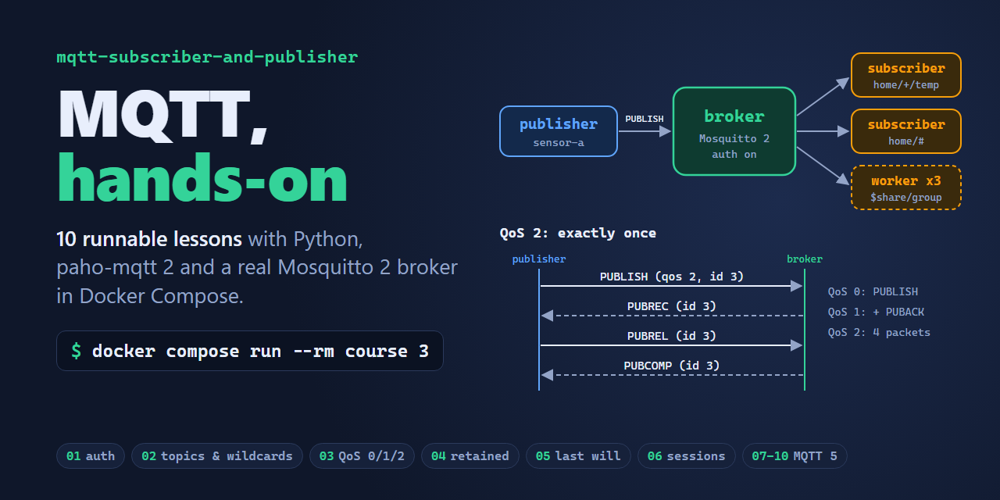
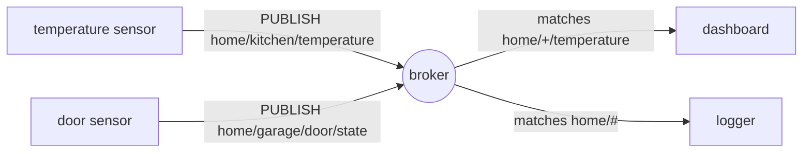
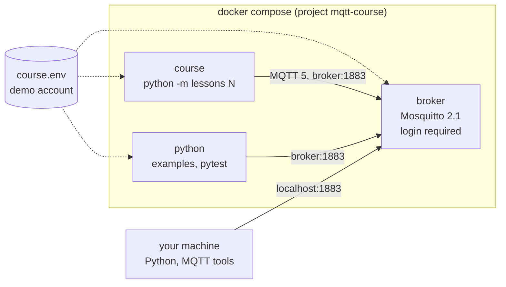

<p align="center">
  
</p>

# MQTT Subscriber and Publisher, hands-on

[](https://github.com/NatLee/mqtt-subscriber-and-publisher/actions/workflows/ci.yml)


[](LICENSE)

Learn MQTT by running it. This repo started as a small Python example, a
publisher and a background subscriber, and that example is still here. Around
it is now a hands-on course: a real Mosquitto 2 broker in Docker Compose, with
login turned on, and ten short lessons from topics and QoS to MQTT 5 shared
subscriptions. Each lesson is one command. It prints what happens packet by
packet, explains itself with a sequence diagram, and has a test that checks it
against the broker on every push.

## MQTT in 30 seconds

MQTT is a publish/subscribe protocol for small devices and flaky networks.
Clients never talk to each other directly. They connect to a **broker**,
**publish** messages to named **topics**, and **subscribe** to the topics they
care about. The broker passes each message to every matching subscriber.



Publishers don't know who listens, and subscribers don't know who publishes.
The lessons show what that buys you, and where its sharp edges are.

## Quick start

You need Docker with Compose v2. Nothing else: Python runs in a container.

```bash
git clone https://github.com/NatLee/mqtt-subscriber-and-publisher.git
cd mqtt-subscriber-and-publisher
docker compose run --rm course
```

The first run builds a small Python image and starts the broker. Then it lists
the lessons:

```text
MQTT hands-on course. Pick a lesson:

   1  Connect and log in
   2  Topics and wildcards
   3  QoS 0, 1 and 2
   4  Retained messages
   5  Last will and testament
   6  Clean and persistent sessions
   7  MQTT 5: user properties
   8  MQTT 5: message expiry
   9  MQTT 5: shared subscriptions
  10  MQTT 5: request / response

usage: python -m lessons [NUMBER | all]
(in Docker: docker compose run --rm course NUMBER)
```

Run one with `docker compose run --rm course 3`, all of them with
`docker compose run --rm course all`, and stop the broker with
`docker compose down`.

## Lessons

| # | Lesson | You'll see |
|---|---|---|
| 1 | [Connect and log in](lessons/01_connect.md) | Mosquitto 2 refusing anonymous clients, CONNACK reason codes, `$SYS` topics |
| 2 | [Topics and wildcards](lessons/02_topics.md) | which of five filters (`+`, `#`) catch which of six topics |
| 3 | [QoS 0, 1 and 2](lessons/03_qos.md) | the real packet exchange per QoS, QoS downgrade, a QoS 1 message delivered twice |
| 4 | [Retained messages](lessons/04_retained.md) | late subscribers getting the last known value, and deleting it |
| 5 | [Last will and testament](lessons/05_last_will.md) | the broker announcing a client that vanished, via keep-alive |
| 6 | [Clean and persistent sessions](lessons/06_sessions.md) | messages queued for an offline client, and what a clean start forgets |
| 7 | [MQTT 5: user properties](lessons/07_user_properties.md) | content type and header-like metadata riding along with a message |
| 8 | [MQTT 5: message expiry](lessons/08_message_expiry.md) | a stale offer disappearing from the broker |
| 9 | [MQTT 5: shared subscriptions](lessons/09_shared_subscriptions.md) | three workers splitting nine jobs |
| 10 | [MQTT 5: request / response](lessons/10_request_response.md) | response topic and correlation data pairing answers with questions |

This is lesson 3 tracing the packets of each QoS level, from
`docker compose run --rm course 3`:

```text
2. QoS 1: at least once
   publisher <-> broker    >> PUBLISH (qos 1, id 2)   << PUBACK (id 2)
   broker <-> subscriber   << PUBLISH (qos 1, id 1)   >> PUBACK (id 1)
   [ok] subscriber got 'reading #2' with QoS 1

3. QoS 2: exactly once
   publisher <-> broker    >> PUBLISH (qos 2, id 3)   << PUBREC (id 3)   >> PUBREL (id 3)   << PUBCOMP (id 3)
   broker <-> subscriber   << PUBLISH (qos 2, id 2)   >> PUBREC (id 2)   << PUBREL (id 2)   >> PUBCOMP (id 2)
   [ok] subscriber got 'reading #3' with QoS 2
```

The lessons live in [`lessons/`](lessons). The repo is mounted into the
container, so you can edit a lesson and run it again without rebuilding.

## How it fits together



- **broker** runs `eclipse-mosquitto:2.1.2-alpine` with
  [`broker/mosquitto.conf`](broker/mosquitto.conf). On start,
  [`broker/start.sh`](broker/start.sh) turns the demo account in
  [`course.env`](course.env) (`student` / `learn-mqtt`) into a hashed password
  file.
- **course** runs the lessons and **python** runs any other script. Both
  use the same small image ([`Dockerfile`](Dockerfile)) and get the broker
  address and account from compose.
- Port 1883 is published on your machine too, so local tools can connect. If
  1883 is already taken, start the broker with
  `MQTT_HOST_PORT=1884 docker compose up -d broker` and give local Python
  `MQTT_PORT=1884`.

### Why the broker asks for a password

Mosquitto 2.0 became secure by default. As soon as a config file defines a
`listener`, anonymous clients are refused unless you set
`allow_anonymous true`. Before 2.0, a fresh install accepted anyone on any
network interface, and internet scans kept finding open brokers that leaked
whatever passed through them. The course keeps the safe default and logs in
with a demo account; [lesson 1](lessons/01_connect.md) shows what the broker
says to strangers.

## The original example: a publisher and a background subscriber

[`mqttUtils/`](mqttUtils) has the two classes the repo started with:

- `MqttSender(topic, hostname, port=1883)` sends any Python object (a dict,
  a list, bytes, a NumPy array) to one topic with `send(data)`.
- `MqttSubscriber(host, topics, port=1883)` connects, subscribes to a list of
  topics, and prints every message. Call `client.loop_start()` and it listens
  on a background thread while your program does other things.

Both take optional `username=` and `password=` keyword arguments.

Run them against the course broker, the subscriber in one terminal:

```console
$ docker compose run --rm python example_subscriber.py
Connected with result code 0
Subscribed to yoo, yee
```

and the sender in another:

```console
$ docker compose run --rm python example_send.py
Sent 4 messages to broker:1883 as 'student'
```

The subscriber prints what arrived; stop it with Ctrl+C:

```text
yee {'test1': 1234, 'test2': 'yee'}
yoo 1234
yoo b'ABCDEFG'
yoo ['1', 'a', 'b']
Exit!
```

Without Docker, the examples connect to Eclipse's public test broker
`test.mosquitto.org` (no login, everyone can read everything), as they always
have:

```bash
pip install -r requirements.txt
python example_subscriber.py
python example_send.py   # in a second terminal
```

Set `MQTT_HOST`, `MQTT_PORT`, `MQTT_USERNAME` and `MQTT_PASSWORD` to use
another broker. Some networks block outgoing port 1883; if the public broker
times out, use the course broker instead.

In your own code:

```python
from mqttUtils import MqttSender, MqttSubscriber

subscriber = MqttSubscriber("localhost", ["sensors/#"], username="student", password="learn-mqtt")
subscriber.client.loop_start()  # listen in the background

MqttSender("sensors/kitchen", "localhost", username="student", password="learn-mqtt").send({"temp": 21.5})
```

### A word on pickle

The classes use Python's pickle format, so any object survives the trip. But
unpickling can run code, and on a shared broker anyone may publish to your
topic. So the subscriber only rebuilds plain data: built-in types and NumPy
arrays. Anything else is skipped with a message instead of running. If you
control every sender and need more types, override `MqttSubscriber.decode()`
(see [`mqttUtils/serialization.py`](mqttUtils/serialization.py)). To talk to
programs in other languages, send JSON instead, as lesson 7 does.

## Run it with your own Python

The lessons and tests also run on Python 3.10 or newer on your machine. They
find the broker on `localhost:1883` and read the demo account from
`course.env`:

```bash
pip install -r requirements-dev.txt
docker compose up -d --wait broker
python -m lessons 3
pytest
```

## Tests

Every lesson has a test in [`tests/`](tests) that runs it against the broker
and checks what it observed: the packet sequence of each QoS level, the retain
flags, which sensor's will was published, and so on. The original example has
end-to-end tests too.

```console
$ docker compose run --rm python -m pytest -q
...........................................................              [100%]
59 passed in 18.88s
```

[CI](.github/workflows/ci.yml) runs the suite in Docker Compose, runs every
lesson with `docker compose run --rm course all`, and runs the tests again on
Python 3.10 and 3.14 outside Docker.

## Project layout

```text
broker/            Mosquitto config and the start script that creates the password file
lessons/           the course: NN_topic.py (code) + NN_topic.md (explanation) per lesson
mqttUtils/         the original MqttSender / MqttSubscriber, plus settings and safe pickle
tests/             pytest suite, one file per lesson
example_send.py    the original publisher example
example_subscriber.py   the original background subscriber example
compose.yaml       broker + Python containers
course.env         demo account shared by the broker and the clients
```

## License

[MIT](LICENSE)
