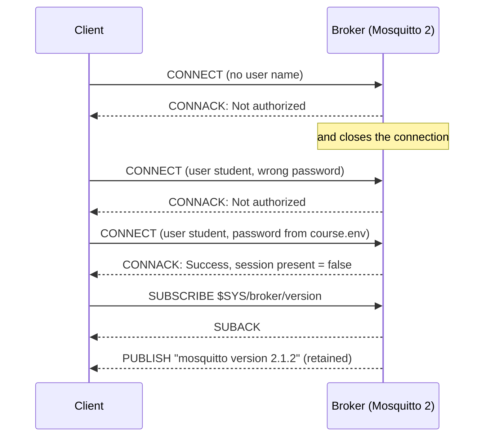

# Lesson 1 · Connect and log in

```bash
docker compose run --rm course 1
```

Every MQTT conversation starts the same way: the client opens a TCP connection
to the broker and sends a **CONNECT** packet. The broker answers with
**CONNACK**, which carries a reason code: `Success`, or why not.

CONNECT carries, among other things:

| Field | What it is for |
|---|---|
| Client ID | The broker files your session under this name (lesson 6). Two clients with the same ID kick each other out. |
| Keep alive | How often the client promises to say something, even just a ping (lesson 5). |
| Clean start | Start a fresh session, or resume the one you had (lesson 6). |
| User name / password | Who you are. |
| Will | A message the broker should publish if you vanish (lesson 5). |

## Why the course broker wants a password

Mosquitto 2.0 became *secure by default*. Before 2.0, a fresh install listened
on every network interface and accepted anyone, and internet-wide scans kept
finding tens of thousands of brokers that leaked data to whoever asked. Since
2.0:

- with no `listener` in the config, Mosquitto only accepts connections from the
  same machine;
- as soon as you add a `listener`, anonymous clients are refused unless you set
  `allow_anonymous true`.

[`broker/mosquitto.conf`](../broker/mosquitto.conf) keeps anonymous access off
and loads the password-file plugin. [`broker/start.sh`](../broker/start.sh)
creates that file from [`course.env`](../course.env) with `mosquitto_passwd`
when the broker starts, so only a hash ever exists, and only inside the
container.

Two more things to notice in the output below:

- A wrong password and a missing user name get the same answer, `Not authorized`.
  The broker doesn't tell a stranger which user names exist.
- On port 1883 the password travels as plain text. On a network you don't
  control, use MQTT over TLS (port 8883).



## What you'll see

```text
1. Connect without a user name
   [ok] CONNACK: Not authorized  (Mosquitto 2 refuses anonymous clients)

2. Connect with a wrong password
   [ok] CONNACK: Not authorized

3. Connect as 'student' from course.env
   [ok] CONNACK: Success
   session present: False  (a brand-new session)
   the broker also told us its limits: ReceiveMaximum=20, TopicAliasMaximum=10, MaximumPacketSize=2000000

4. Ask the broker who it is
   $SYS/broker/version = 'mosquitto version 2.1.2'
```

The limits are MQTT 5 CONNACK properties: at most 20 unacknowledged QoS 1/2
messages in flight towards the broker, up to 10 topic aliases, and packets up
to 2 MB. `$SYS/...` topics are published by the broker itself: uptime, client
counts, message rates.

## Try it

The broker image ships the `mosquitto_sub` and `mosquitto_pub` command-line
clients. Without a login:

```console
$ docker compose exec broker mosquitto_sub -t '$SYS/broker/version' -C 1
Connection error: Connection Refused: not authorised
```

With the demo account (`-C 1`: stop after one message, `-v`: print the topic):

```console
$ docker compose exec broker mosquitto_sub -u student -P learn-mqtt -t '$SYS/broker/version' -C 1 -v
$SYS/broker/version mosquitto version 2.1.2
```

Code: [`01_connect.py`](01_connect.py) · Test: [`tests/test_01_connect.py`](../tests/test_01_connect.py)
