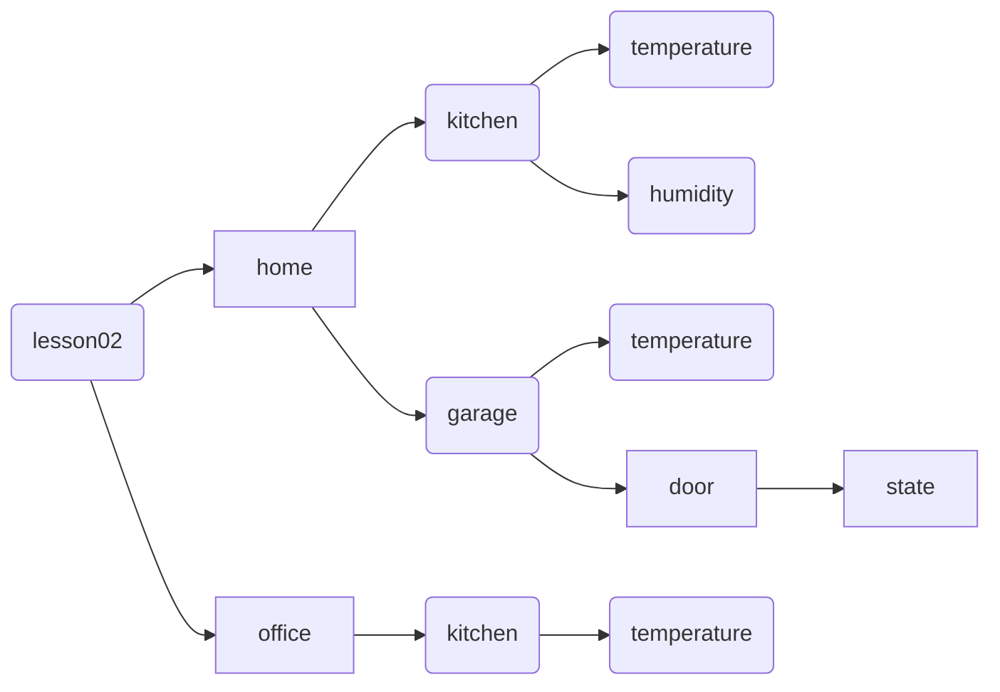
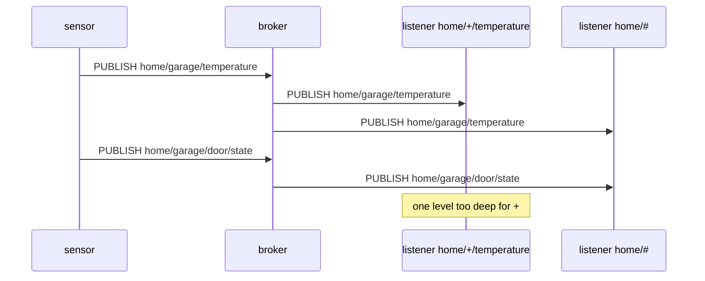

# Lesson 2 · Topics and wildcards

```bash
docker compose run --rm course 2
```

A **topic** is the address of a message: a UTF-8 string such as
`home/kitchen/temperature`. Slashes split it into **levels**. There is no
"create topic" step: publishing to a topic is all it takes.

Publishers always name one exact topic. Subscribers give a **topic filter**,
which may use two wildcards:

| Wildcard | Matches | Example filter | Matches | Does not match |
|---|---|---|---|---|
| `+` | exactly one level | `home/+/temperature` | `home/garage/temperature` | `home/garage/door/state` |
| `#` | this level and everything below; must be last | `home/#` | `home`, `home/garage/door/state` | `office/kitchen/temperature` |

A few rules that catch people out:

- Topics are case-sensitive: `Home` and `home` are different.
- `/home` starts with an empty level, so it is not the same topic as `home`.
- Wildcards at the start of a filter don't match topics that begin with `$`
  (such as `$SYS/...`), so `#` alone means "every application topic".
- Wildcards only exist in subscriptions. You can't publish to `home/+`.

The lesson publishes to the six topics of this tree. Every topic sits under
`lesson02/`, so the lessons don't hear each other.



Five clients subscribe, one filter each, and report what reached them:



## What you'll see

```text
3. Which listener heard what
   home/kitchen/temperature   heard 1: home/kitchen/temperature
   home/+/temperature         heard 2: home/kitchen/temperature, home/garage/temperature
   home/#                     heard 5: home, home/kitchen/temperature, home/kitchen/humidity, home/garage/temperature, home/garage/door/state
   +/kitchen/#                heard 3: home/kitchen/temperature, home/kitchen/humidity, office/kitchen/temperature
   +/+/temperature            heard 3: home/kitchen/temperature, home/garage/temperature, office/kitchen/temperature

   [ok] the broker matched exactly what paho.mqtt.client.topic_matches_sub predicts
```

`topic_matches_sub(filter, topic)` is paho's own matcher. It is handy in tests,
or when one callback handles several filters.

## Try it

Watch the lesson's traffic from a second terminal while you run it
(`-v` prints the topic in front of each payload):

```console
$ docker compose exec broker mosquitto_sub -u student -P learn-mqtt -t 'lesson02/#' -v
lesson02/home hello from home
lesson02/home/kitchen/temperature hello from home/kitchen/temperature
lesson02/home/kitchen/humidity hello from home/kitchen/humidity
lesson02/home/garage/temperature hello from home/garage/temperature
lesson02/home/garage/door/state hello from home/garage/door/state
lesson02/office/kitchen/temperature hello from office/kitchen/temperature
```

Then change `FILTERS` in [`02_topics.py`](02_topics.py) and run the lesson
again; no rebuild is needed.

Code: [`02_topics.py`](02_topics.py) · Test: [`tests/test_02_topics.py`](../tests/test_02_topics.py)
