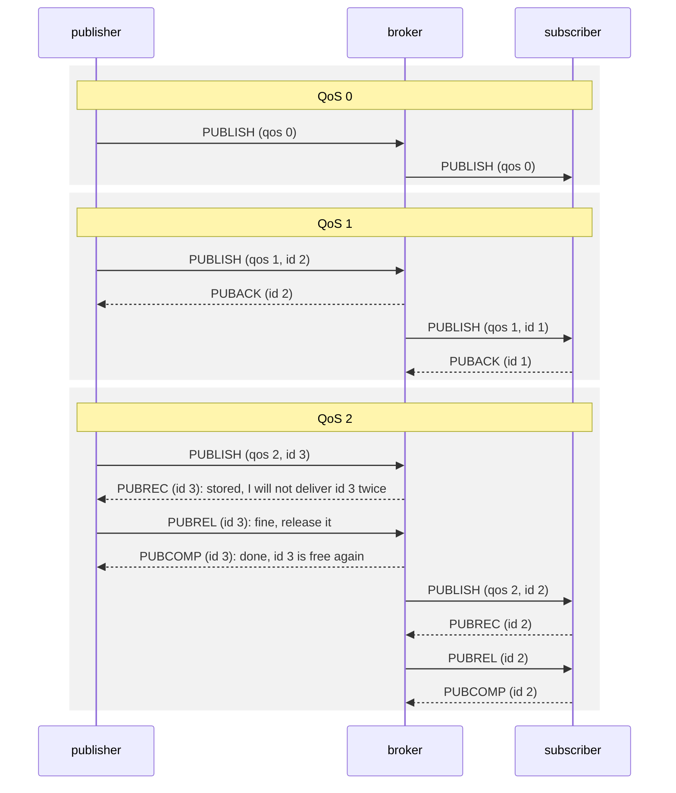
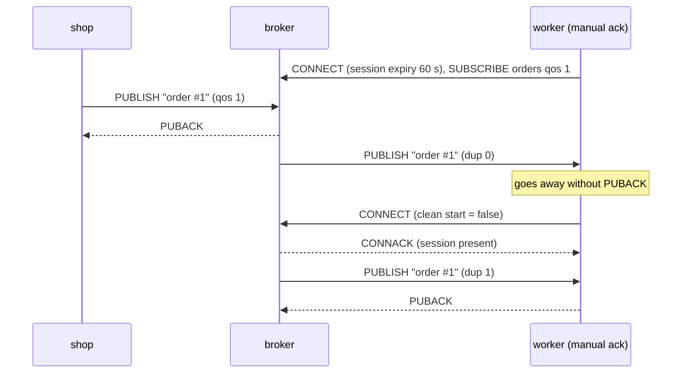

# Lesson 3 · QoS 0, 1 and 2

```bash
docker compose run --rm course 3
```

**QoS** (quality of service) is how hard MQTT tries to deliver a message. The
publisher picks a level per message:

| QoS | Promise | Packets on each hop | Price |
|---|---|---|---|
| 0 | at most once: may be lost, never duplicated | PUBLISH | cheapest, fire and forget |
| 1 | at least once: never lost, may arrive twice | PUBLISH, PUBACK | one round trip |
| 2 | exactly once: never lost, never duplicated | PUBLISH, PUBREC, PUBREL, PUBCOMP | two round trips |

"Never lost" holds as long as the sender's session lives: the sender keeps the
message and sends it again until the acknowledgement arrives.

Each **hop** runs its own handshake: publisher to broker, then broker to each
subscriber. The lesson traces the packets paho sends (`>>`) and receives (`<<`)
on both hops.



The **packet id** ties the acknowledgements to their PUBLISH. Each hop numbers
its own packets, so the same message is id 3 on one hop and id 2 on the next.
QoS 0 needs no id at all.

QoS 2 gets "exactly once" from the extra round trip. After PUBREC, the receiver
remembers the packet id and drops any repeat PUBLISH with that id. PUBREL tells
it that it can forget the id, and PUBCOMP closes the exchange.

## The subscriber has a say too

A subscription has a QoS as well. Delivery uses the **lower** of the two:
publish with QoS 2 to a QoS 0 subscription, and the subscriber gets QoS 0.

## At least once can mean twice

The last part shows why QoS 1 says "at least". The worker receives an order,
then goes away before it sends PUBACK. The broker still has the order in the
worker's session, so it sends the order again when the worker comes back. The
second copy has the **DUP** flag set. Handlers for QoS 1 should cope with
duplicates, for example by ignoring an order ID they have already processed.



## What you'll see

```text
1. QoS 0: at most once
   publisher <-> broker    >> PUBLISH (qos 0)
   broker <-> subscriber   << PUBLISH (qos 0)
   [ok] subscriber got 'reading #1' with QoS 0

2. QoS 1: at least once
   publisher <-> broker    >> PUBLISH (qos 1, id 2)   << PUBACK (id 2)
   broker <-> subscriber   << PUBLISH (qos 1, id 1)   >> PUBACK (id 1)
   [ok] subscriber got 'reading #2' with QoS 1

3. QoS 2: exactly once
   publisher <-> broker    >> PUBLISH (qos 2, id 3)   << PUBREC (id 3)   >> PUBREL (id 3)   << PUBCOMP (id 3)
   broker <-> subscriber   << PUBLISH (qos 2, id 2)   >> PUBREC (id 2)   << PUBREL (id 2)   >> PUBCOMP (id 2)
   [ok] subscriber got 'reading #3' with QoS 2

4. The subscriber has a say too: delivered QoS = min(publish QoS, subscription QoS)
   listener subscribed with QoS 0, SUBACK granted QoS 0
   [ok] published with QoS 2, delivered with QoS 0

5. At least once can mean twice: an unacknowledged QoS 1 message comes back
   worker got 'order #1' (dup=False) and goes away without a PUBACK
   worker is back (session present: True), got 'order #1' again (dup=True)
   [ok] same message delivered twice: make handlers idempotent
```

## Which level should I use?

- **QoS 0** for frequent readings where the next value replaces the last
  (temperature every second).
- **QoS 1** for most events and commands, with handlers that tolerate repeats.
- **QoS 2** when a duplicate would do harm and you can't make the handler
  idempotent. It costs an extra round trip per message.

Code: [`03_qos.py`](03_qos.py) · Test: [`tests/test_03_qos.py`](../tests/test_03_qos.py)
