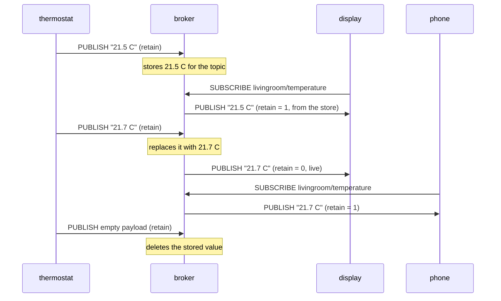

# Lesson 4 · Retained messages

```bash
docker compose run --rm course 4
```

Normally the broker forwards a message to whoever is subscribed *right now*
and then forgets it. A client that subscribes a minute later has to wait for
the next message. For a sensor that reports every hour, that's a long wait.

Set the **retain** flag and the broker also keeps the message as the topic's
"last known value". Anyone who subscribes later gets it immediately.

- The broker keeps **one** retained message per topic; a new one replaces it.
- Messages delivered from that store arrive with `retain=True`. Messages that
  arrive live, while you are subscribed, have `retain=False`. That's how a
  client tells "stored value" from "fresh update".
- To delete a retained message, publish an **empty** retained message to the
  topic.



## What you'll see

```text
1. The thermostat publishes 21.5 C with the retain flag, nobody is listening
   the broker keeps the last retained message of each topic

2. A display subscribes later and gets the value at once
   [ok] display got '21.5 C' with retain=True (stored value)

3. A live update reaches current subscribers with retain=False
   [ok] display got '21.7 C' with retain=False (live)

4. A phone joins: only the latest retained value is kept
   [ok] phone got '21.7 C' with retain=True

5. Delete the retained value by publishing an empty retained message
   [ok] tablet joined and got 0 messages
```

Retained messages survive the publisher going away; lesson 5 builds on that.
MQTT 5 adds a subscribe option, *retain handling*: send retained messages on
every subscribe (0, the default), only on a new subscription (1), or never (2).
With paho: `client.subscribe(topic, options=SubscribeOptions(qos=1, retainHandling=2))`.

## Try it

```console
$ docker compose exec broker mosquitto_pub -u student -P learn-mqtt -t lesson04/try -m 'hello, late joiner' -r
$ docker compose exec broker mosquitto_sub -u student -P learn-mqtt -t lesson04/try -C 1 -F '%t %p (retained: %r)'
lesson04/try hello, late joiner (retained: 1)
$ docker compose exec broker mosquitto_pub -u student -P learn-mqtt -t lesson04/try -n -r
```

`-r` sets the retain flag; `-n` sends an empty payload, which deletes the
retained message again.

Code: [`04_retained.py`](04_retained.py) · Test: [`tests/test_04_retained.py`](../tests/test_04_retained.py)
