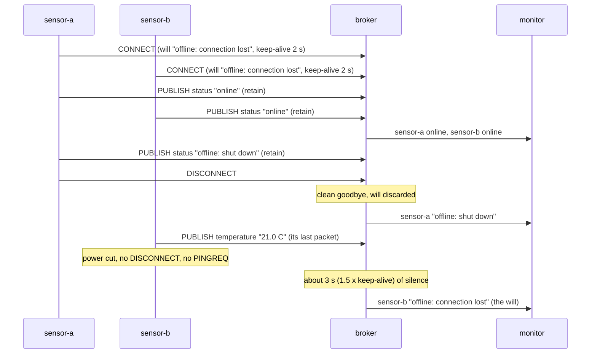

# Lesson 5 · Last will and testament

```bash
docker compose run --rm course 5
```

Devices drop off the network all the time: batteries die, Wi-Fi fades, a
process crashes. A vanished client can't announce that it's gone, so MQTT lets
it leave a **will** with the broker in advance, inside the CONNECT packet.

- If the connection ends **without** a DISCONNECT packet, the broker publishes
  the will for the client.
- If the client disconnects politely, the broker throws the will away.

How does the broker notice silence? Through the **keep-alive** the client asked
for in CONNECT. When the client has nothing to send, it sends a tiny PINGREQ
and the broker answers PINGRESP. After 1.5 × keep-alive seconds without any
packet, the broker gives up on the client and publishes its will. Mosquitto
keeps this time in whole seconds, so the will can come up to a second early.

## The online/offline pattern

Combine the will with retained messages (lesson 4) and every device gets a
status topic that is always right:

1. Connect with a **retained** will: `offline: connection lost`.
2. Right after connecting, publish a retained `online` (the "birth" message).
3. On a clean shutdown, publish a retained `offline: shut down` yourself, then
   DISCONNECT. The broker discards the will, so if you skip this step the
   topic stays `online` forever.



## What you'll see

```text
1. Two sensors connect with a will ('offline: connection lost') and say 'online'
   monitor: lesson05/sensor-a/status = 'online'
   monitor: lesson05/sensor-b/status = 'online'

2. sensor-a shuts down politely: it says goodbye itself, then DISCONNECT
   monitor: lesson05/sensor-a/status = 'offline: shut down'
   a clean DISCONNECT tells the broker to throw the will away

3. sensor-b sends a last reading, then loses power (keep-alive 2 s)
   no DISCONNECT, and no more PINGREQ keep-alives either
   monitor: lesson05/sensor-b/status = 'offline: connection lost'
   the broker published the will 2.3 s later (1.5 x keep-alive = 3 s, timed by a clock that ticks in whole seconds)

4. A dashboard that starts now reads the retained statuses
   sensor-a: 'offline: shut down'
   sensor-b: 'offline: connection lost'
   [ok] only the sensor that vanished got its will published
```

The lesson "cuts the power" by stopping paho's network thread
(`client.loop_stop()`) without calling `disconnect()`. The broker log shows how
it noticed:

```console
$ docker compose logs broker | grep sensor-b
broker-1  | 22:52:09: New client connected from 172.25.0.3:32933 as lesson05-sensor-b (p5, c1, k2, u'student').
broker-1  | 22:52:12: Client lesson05-sensor-b [172.25.0.3:32933] disconnected: exceeded timeout.
```

`k2` is the keep-alive, `p5` means MQTT 5. MQTT 5 adds two will options:
a **will delay** (wait a few seconds in case the client reconnects), and
DISCONNECT with reason code 4, which leaves on purpose *and* asks for the will.

Code: [`05_last_will.py`](05_last_will.py) · Test: [`tests/test_05_last_will.py`](../tests/test_05_last_will.py)
