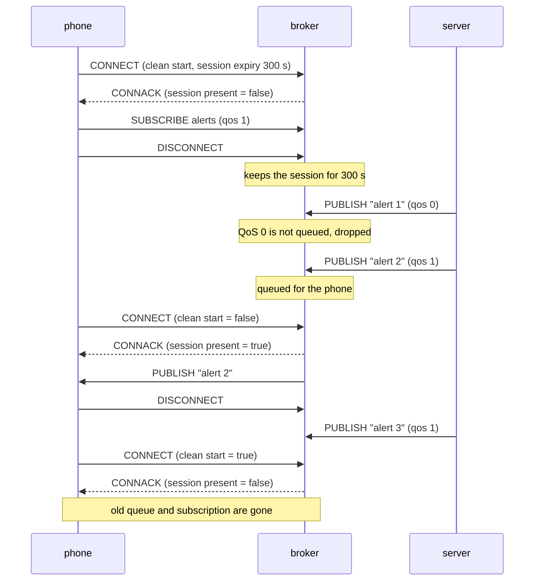

# Lesson 6 · Clean and persistent sessions

```bash
docker compose run --rm course 6
```

For every client ID the broker keeps a **session**:

- the client's subscriptions;
- QoS 1 and 2 messages that arrived while the client was offline;
- QoS 1 and 2 messages that were sent but not yet acknowledged (lesson 3).

The client decides what happens to that session. MQTT 5 uses two settings in
CONNECT:

| Setting | Meaning |
|---|---|
| `clean_start=True` | Throw away any old session and start empty. |
| `clean_start=False` | Resume the old session if the broker still has it. |
| Session Expiry Interval | How many seconds the broker keeps the session after a disconnect. 0 (the default) ends it with the connection. |

CONNACK answers with **session present**, so the client knows whether it must
subscribe again.

MQTT 3.1.1 had a single flag, `clean_session`. `clean_session=1` works like
`clean_start=True` with expiry 0. `clean_session=0` works like
`clean_start=False` with a session that never expires.



## What you'll see

```text
1. The phone connects, asks the broker to keep its session for 300 s, subscribes
   CONNACK session present: False
   phone goes offline (tunnel, flight mode, ...)

2. Alerts are sent while the phone is offline
   server -> lesson06/alerts: 'alert 1 (QoS 0)'
   server -> lesson06/alerts: 'alert 2 (QoS 1)'

3. The phone comes back with clean_start=False: resume the old session
   CONNACK session present: True  (no need to subscribe again)
   queued for the phone: ['alert 2 (QoS 1)']
   [ok] QoS 1 waited for the phone, QoS 0 was not queued

4. Another alert, then the phone reconnects with clean_start=True
   server -> lesson06/alerts: 'alert 3 (QoS 1)'
   CONNACK session present: False
   [ok] a clean start threw away the queue and the subscription: got []
```

Things to keep in mind:

- A persistent session only works with a **fixed client ID**. A random ID
  each time starts a new session each time.
- The broker drops QoS 0 messages for offline clients. Mosquitto can queue them
  (`queue_qos0_messages true`), but other brokers may not.
- Queues aren't endless. Mosquitto keeps up to 1000 messages per client by
  default (`max_queued_messages`).

## Try it

The command-line clients can play the phone too (`-c`: don't start clean,
`-i`: client ID, `-x`: session expiry, `-W 1`: leave after one second):

```console
$ docker compose exec broker mosquitto_sub -V 5 -u student -P learn-mqtt -t lesson06/alerts -q 1 -c -i try-phone -x 300 -W 1
Timed out
$ docker compose exec broker mosquitto_pub -u student -P learn-mqtt -t lesson06/alerts -q 1 -m 'sent while you were away'
$ docker compose exec broker mosquitto_sub -V 5 -u student -P learn-mqtt -t lesson06/alerts -q 1 -c -i try-phone -x 0 -C 1 -v
lesson06/alerts sent while you were away
```

Code: [`06_sessions.py`](06_sessions.py) · Test: [`tests/test_06_sessions.py`](../tests/test_06_sessions.py)
