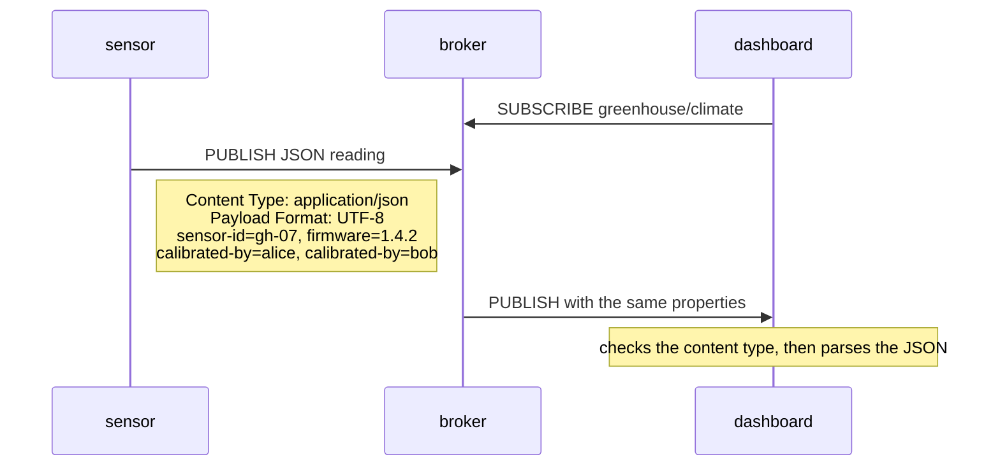

# Lesson 7 · MQTT 5: user properties

```bash
docker compose run --rm course 7
```

In MQTT 3.1.1 a message was a topic plus a payload, and nothing else. Any
extra facts (which sensor, which units, which format) had to be squeezed into
the payload or the topic name. MQTT 5 adds **properties** to most packets.
Three of them describe a PUBLISH:

| Property | What it says |
|---|---|
| Content Type | A MIME type for the payload, e.g. `application/json`. |
| Payload Format Indicator | `1` = the payload is UTF-8 text, `0` = raw bytes. |
| User Property | Any number of `(name, value)` string pairs. Order is kept and a name may repeat. Think HTTP headers. |

The broker passes them to subscribers unchanged. A receiver can route or
validate on them without parsing the payload, and the payload stays clean data.



With paho, properties are a `Properties` object for the packet type:

```python
from paho.mqtt.packettypes import PacketTypes
from paho.mqtt.properties import Properties

properties = Properties(PacketTypes.PUBLISH)
properties.ContentType = "application/json"
properties.UserProperty = [("sensor-id", "gh-07"), ("firmware", "1.4.2")]
client.publish("greenhouse/climate", payload, qos=1, properties=properties)
```

On the receiving side they are in `message.properties`. The lesson uses a small
helper, `publish_properties(ContentType=..., UserProperty=...)`, that does the
same thing.

## What you'll see

```text
2. The sensor publishes JSON, and describes it in properties
   payload: {"temperature": 24.5, "humidity": 61}
   user property sensor-id = gh-07
   user property firmware = 1.4.2
   user property calibrated-by = alice
   user property calibrated-by = bob

3. The dashboard reads the properties before touching the payload
   content type: application/json, UTF-8 text: True
   user properties: [('sensor-id', 'gh-07'), ('firmware', '1.4.2'), ('calibrated-by', 'alice'), ('calibrated-by', 'bob')]
   [ok] decoded the JSON reading: {'temperature': 24.5, 'humidity': 61}
```

Properties only reach MQTT 5 subscribers: a broker strips them when it forwards
a message to an MQTT 3.1.1 client.

Code: [`07_user_properties.py`](07_user_properties.py) · Test: [`tests/test_07_user_properties.py`](../tests/test_07_user_properties.py)
