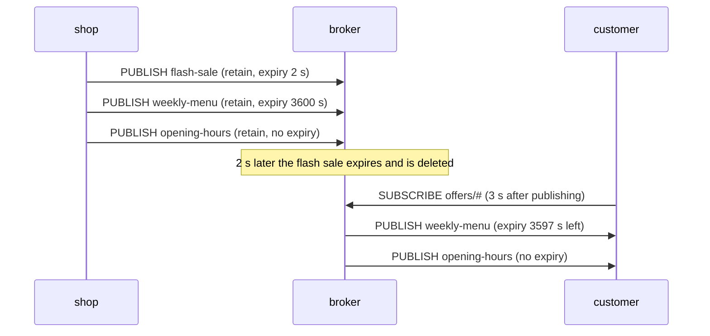

# Lesson 8 · MQTT 5: message expiry

```bash
docker compose run --rm course 8
```

Some messages go stale. "Flash sale, today only" is wrong tomorrow, and a
"turn the heating on" command should not run when a phone reconnects three
days later. MQTT 5 lets the publisher set a **Message Expiry Interval** in
seconds on each message.

- The broker drops the message once that time is up. Expiry applies wherever
  the broker stores it: as the retained value (lesson 4), or queued for an
  offline session (lesson 6).
- When the broker delivers the message, it sends the **remaining** lifetime,
  so a client that forwards the message again doesn't extend its life.
- Without the property, a message never expires.



## What you'll see

```text
1. The shop publishes three retained offers, each with its own lifetime
   lesson08/offers/flash-sale: '50% off, today only', expires after 2 s
   lesson08/offers/weekly-menu: 'soup of the week: pumpkin', expires after 3600 s
   lesson08/offers/opening-hours: '9:00-18:00', never expires

2. A customer opens the app 3 s later
   got lesson08/offers/weekly-menu: 'soup of the week: pumpkin' (3597 s left)
   got lesson08/offers/opening-hours: '9:00-18:00' (no expiry)
   [ok] the flash sale expired and the broker dropped it
```

The remaining time can read 3596 instead of 3597 on a slow run; the broker
counts in whole seconds.

Expiry is the cure for a classic MQTT 3.1.1 trap: a retained command such as
"open the door" that every new subscriber executes again, forever. Give
commands a short expiry, or don't retain them at all.

Code: [`08_message_expiry.py`](08_message_expiry.py) · Test: [`tests/test_08_message_expiry.py`](../tests/test_08_message_expiry.py)
