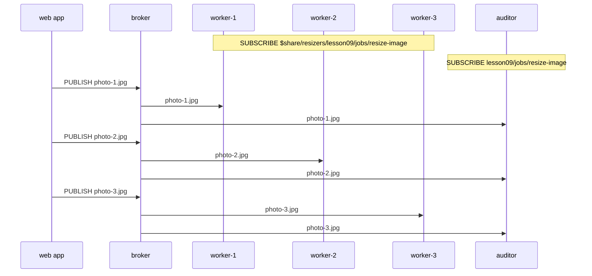

# Lesson 9 · MQTT 5: shared subscriptions

```bash
docker compose run --rm course 9
```

Normally every subscriber gets its own copy of every matching message. That's
what you want for dashboards, and the opposite of what you want for a pool of
workers: three workers would resize every photo three times.

A **shared subscription** puts subscribers into a named group. Each message
goes to **one** member of the group, and the broker picks which one. The filter
has the form:

```text
$share/<group name>/<topic filter>
$share/resizers/lesson09/jobs/resize-image
```

- Publishers don't change at all: they publish to `lesson09/jobs/resize-image`.
- Each group gets one copy. Two groups both see every message, and so do
  normal subscribers, such as the auditor below.
- Add workers to handle more load. If a worker leaves, the rest keep going.
- The broker decides how to spread messages. Mosquitto takes turns (round
  robin); other brokers may pick at random or prefer idle members.



## What you'll see

```text
1. 3 workers join the group 'resizers'; an auditor subscribes normally
   workers subscribe to $share/resizers/lesson09/jobs/resize-image
   auditor subscribes to lesson09/jobs/resize-image

2. The web app publishes 9 jobs to lesson09/jobs/resize-image

3. Each job went to exactly one worker of the group
   worker-1: photo-1.jpg, photo-4.jpg, photo-7.jpg
   worker-2: photo-2.jpg, photo-5.jpg, photo-8.jpg
   worker-3: photo-3.jpg, photo-6.jpg, photo-9.jpg
   auditor: all 9 jobs
   [ok] 9 jobs handled, none twice, none lost
```

Change `WORKERS` in [`09_shared_subscriptions.py`](09_shared_subscriptions.py)
and run it again to watch the jobs spread out differently.

Code: [`09_shared_subscriptions.py`](09_shared_subscriptions.py) · Test: [`tests/test_09_shared_subscriptions.py`](../tests/test_09_shared_subscriptions.py)
