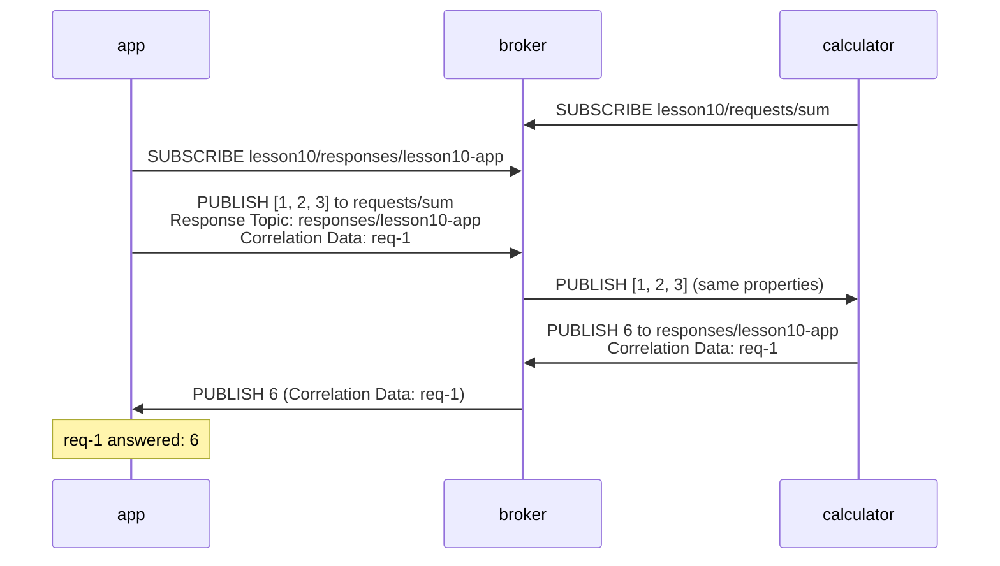

# Lesson 10 · MQTT 5: request / response

```bash
docker compose run --rm course 10
```

Publish/subscribe is one-way: the publisher never hears back. Sometimes you
need an answer anyway ("what's the sum?", "did the valve open?"). MQTT 5 adds
two PUBLISH properties for that:

| Property | Set by the requester to say |
|---|---|
| Response Topic | "Publish the answer here." |
| Correlation Data | "Quote these bytes in the answer, so I know which request it answers." |

The responder just follows the instructions. It publishes the result to the
response topic and copies the correlation data. The requester subscribes to
its own response topic *before* it sends requests. Answers can come back in
any order, and the correlation data pairs each one with its request.



## What you'll see

```text
1. A calculator service listens for requests
   calculator subscribes to lesson10/requests/sum

2. The app subscribes to its own reply topic, then sends three requests
   app -> lesson10/requests/sum: sum[1, 2, 3]  (correlation req-1)
   app -> lesson10/requests/sum: sum[10, 20]  (correlation req-2)
   app -> lesson10/requests/sum: sum[7]  (correlation req-3)

3. Answers come back on the reply topic; correlation data pairs them up
   app <- lesson10/responses/lesson10-app: 6  (correlation req-1)
   app <- lesson10/responses/lesson10-app: 30  (correlation req-2)
   app <- lesson10/responses/lesson10-app: 7  (correlation req-3)
   [ok] every answer matched the request it belongs to
```

The calculator answers from inside a paho callback, which runs on paho's
network thread. It may call `client.publish()` there, but must not wait for
the publish to finish: the thread it would wait on is the one it's blocking.

This is still not HTTP. Nobody guarantees a responder exists, so a real
requester sets a timeout. Combine it with message expiry (lesson 8), and a
request nobody picked up in time disappears instead of running late.

Code: [`10_request_response.py`](10_request_response.py) · Test: [`tests/test_10_request_response.py`](../tests/test_10_request_response.py)
